<picture>
  <source media="(prefers-color-scheme: dark)" srcset="dark_mode.svg">
  <source media="(prefers-color-scheme: light)" srcset="light_mode.svg">
  
</picture>

  <a href="https://rafavieiradev.netlify.app">Portfólio</a> ·
  <a href="https://www.linkedin.com/in/rafael-silva-vieira/">LinkedIn</a> ·
  <a href="mailto:rafasvieira01@gmail.com">Email</a>

<picture>
  <source media="(prefers-color-scheme: dark)" srcset="https://raw.githubusercontent.com/rafavieira1/rafavieira1/output/snake-dark.svg">
  <source media="(prefers-color-scheme: light)" srcset="https://raw.githubusercontent.com/rafavieira1/rafavieira1/output/snake-light.svg">
  
</picture>
